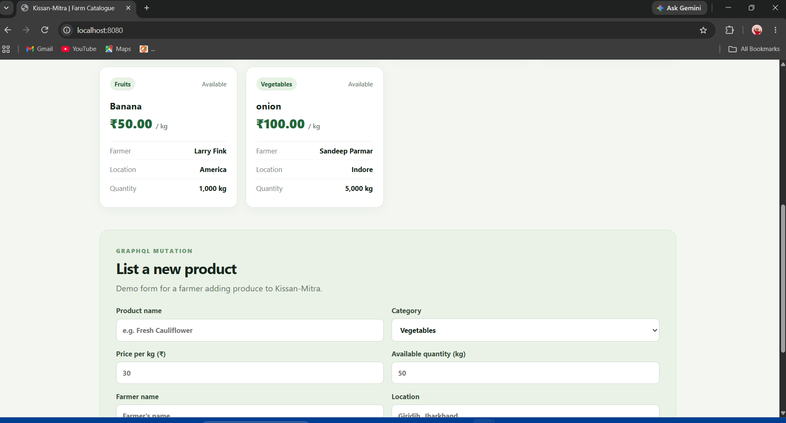
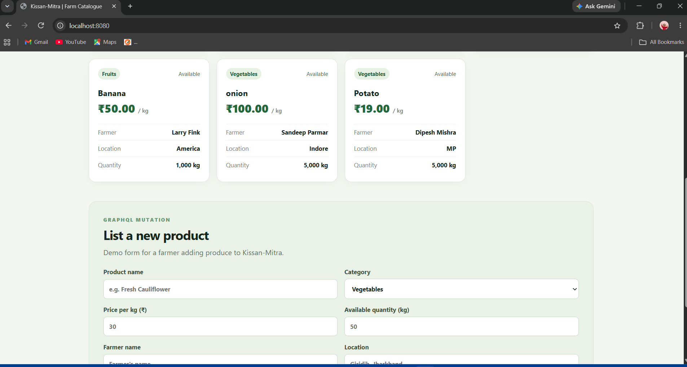

# Kissan-Mitra — CS543 Assignment 07 (GraphQL)

**Team ID:** 19  
**Service selected:** Farm Product Listing  
**Technology:** Node.js, Apollo Server, GraphQL, MySQL, HTML, CSS, JavaScript

This project adapts the Assignment 7 instructions and the GraphQL hands-on tutorial to **Kissan-Mitra**, a farmer-to-buyer marketplace.
## What is included

- `schema.graphql` — GraphQL `Product` type, queries, input type, and mutation.
- `server.js` — Apollo GraphQL API and SQL-backed resolvers.
- `db.js` — MySQL connection pool using environment variables.
- `schema.sql` — database/table setup and four sample products.
- `public/index.html` and `public/style.css` — browser UI that lists available products and adds a product through a GraphQL mutation.
- `docs/assignment-answers.md` — answers to the three required README questions.
- `docs/demo-script.md` — steps for recording the demo.
- `screenshots/` — location for actual before/after screenshots captured while running the app.

## Requirements

- Node.js 18 or newer
- MySQL 8.x (or compatible)
- VS Code with Live Server, or another static HTTP server

## Run on Windows

1. Open PowerShell in this project folder.
2. Install dependencies:

   ```powershell
   npm install
   ```

3. Create `.env` with the password entered securely (the password is not echoed):

   ```powershell
   npm run setup:env
   ```

   This creates the local `.env` file and quotes/escapes the password. `.env` is ignored by Git and is not included in the distributed ZIP. If you prefer to edit it manually, copy `.env.example` to `.env` and set `DB_PASSWORD` to your actual MySQL password; keep it in double quotes, especially if it contains `#`, spaces, quotes, or backslashes.

4. Create the database/table and sample products. Open `schema.sql` in MySQL Workbench and execute it. The script creates `kissan_mitra_graphql` and the `products` table.
5. Run the included schema tests:

   ```powershell
   npm test
   ```

   These tests verify the GraphQL schema and documented query/mutation shapes. They do not replace a live MySQL integration test.
6. Check the database connection:

   ```powershell
   npm run db:check
   ```

   Expected output: `DATABASE CONNECTED: kissan_mitra_graphql`.
7. Start the API:

   ```powershell
   npm start
   ```

   Expected message: `Kissan-Mitra GraphQL API ready at http://localhost:4000/`.
8. Open `http://localhost:4000/` to use Apollo's GraphQL interface. In a second terminal, open `public/index.html` with VS Code Live Server (or another static server). Click **Refresh list**, then add a product to test the mutation and confirm it appears in the catalogue.

If `npm run db:check` reports `ER_ACCESS_DENIED_ERROR`, recreate `.env` using `npm run setup:env` and enter the same password that successfully authenticated with MySQL. If it reports `ER_BAD_DB_ERROR`, execute `schema.sql` in MySQL Workbench. If it reports `ECONNREFUSED`, start the MySQL Windows service and verify port 3306.

## Mutation example

```graphql
mutation {
  addProduct(input: {
    name: "Fresh Cauliflower"
    category: "Vegetables"
    pricePerKg: 32.5
    unit: "kg"
    availableQuantity: 40
    location: "Giridih, Jharkhand"
    farmerName: "Demo Farmer"
    available: true
  }) {
    id
    name
    pricePerKg
  }
}
```

## Assignment answers

See [`docs/assignment-answers.md`](docs/assignment-answers.md).

## Demo and screenshots

## Demo and screenshots

See [`docs/demo-script.md`](docs/demo-script.md) for the demonstration steps.

### Before adding a product


### After adding a product


The screenshots were captured while testing the application locally with the MySQL database.

## Important scope note

This is the Assignment 7 GraphQL demonstration service, not the complete production Kissan-Mitra marketplace. It demonstrates catalogue reads and product creation. Authentication, buyer orders, payments, delivery, and admin workflows remain outside this assignment's one-service scope.
